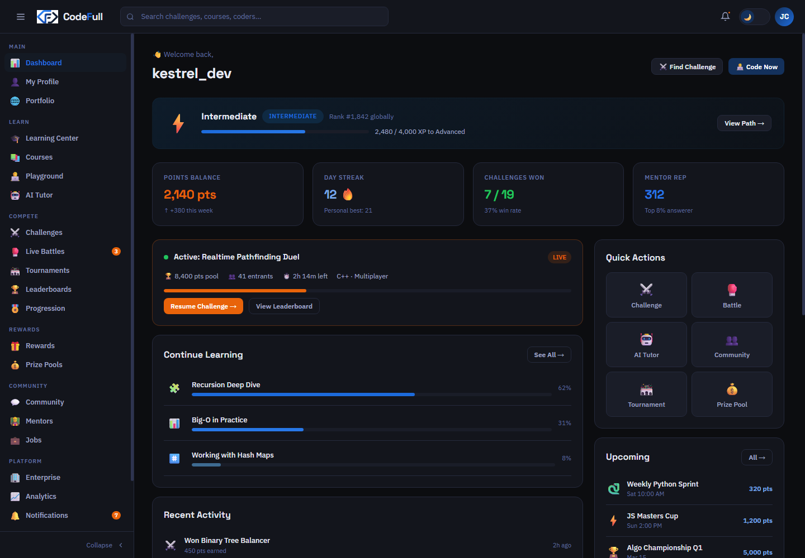
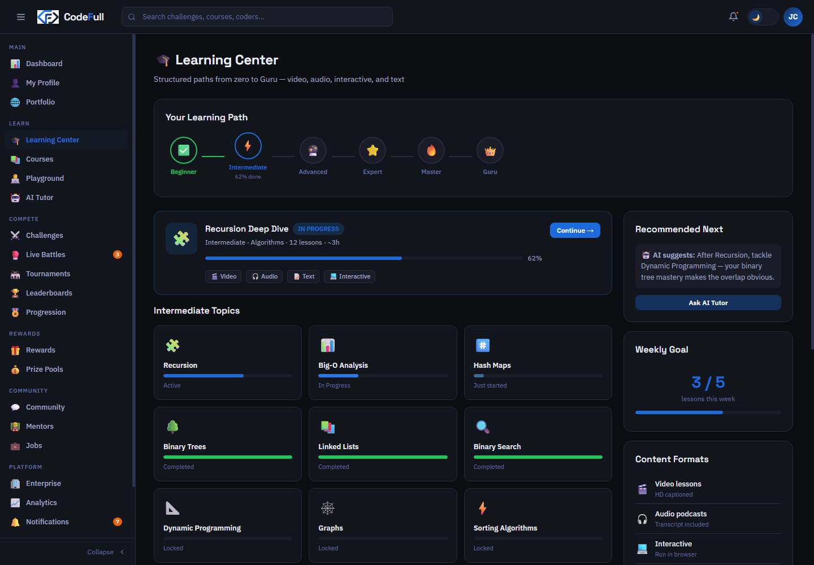
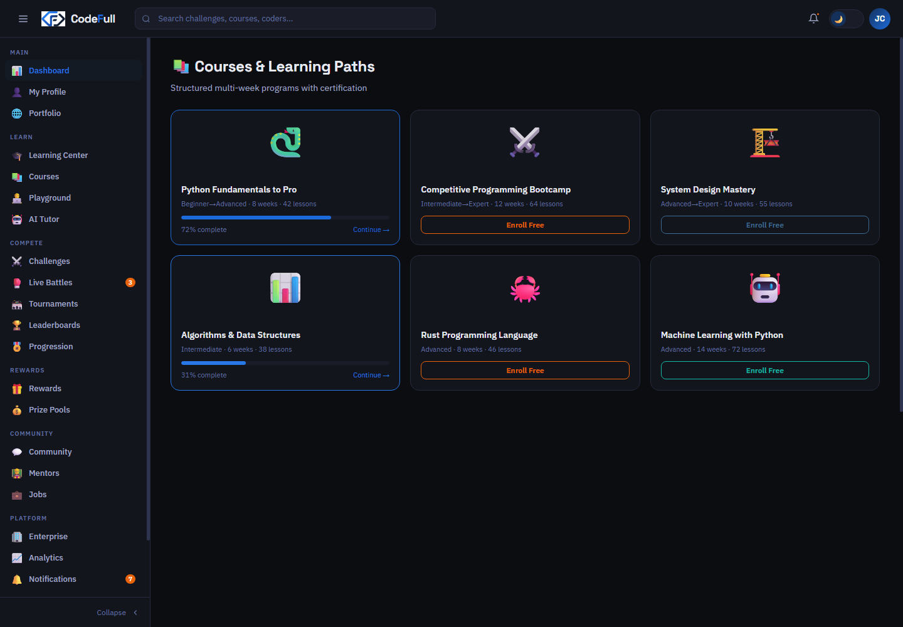
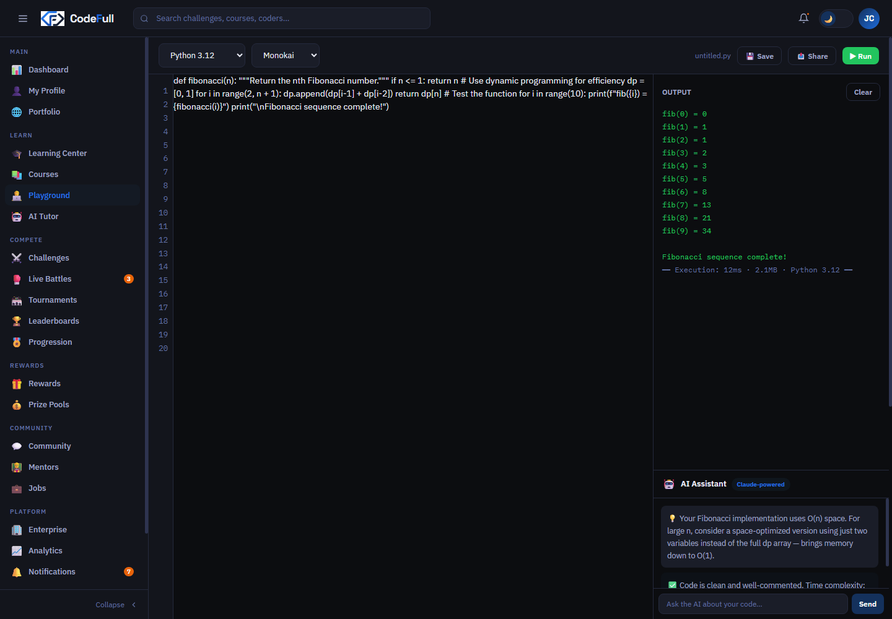
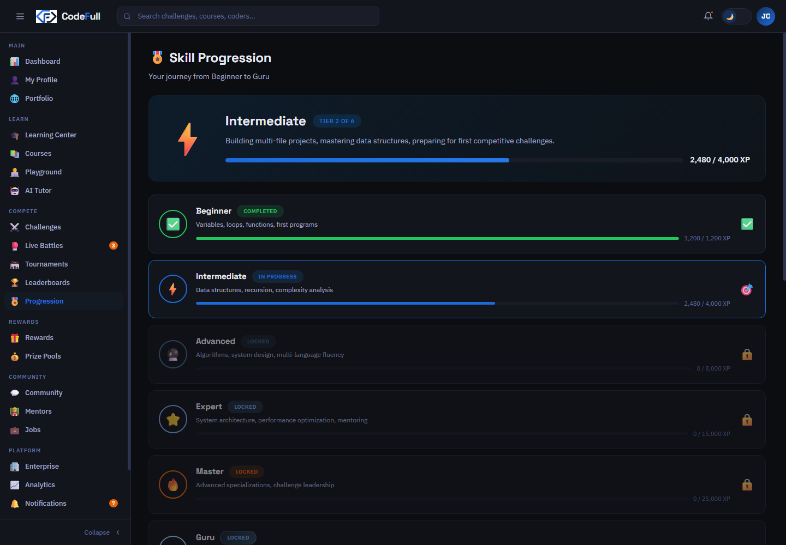

# CodeFull

**Learn. Compete. Earn.** CodeFull is a proposed coding-learning platform that combines guided courses, browser-based practice, programming challenges, community help, and a learner-controlled skills portfolio.

This showcase package brings the supplied product and backend plans together with the original interactive HTML prototype, a draft API contract, design artifacts, and project documentation. The source PRD, SRS, architecture, and security materials are drafts for review; the prototype is not a production application.

## What’s in this package

- [Product overview](docs/index.md), [product spec](docs/product-spec.md), [architecture](docs/architecture.md), [API design](docs/api-design.md), [data model](docs/data-model.md), and [lessons learned](docs/lessons-learned.md).
- Proposed [architecture](docs/assets/architecture.svg), [code-run flow](docs/assets/code-run-flow.svg), and [data model](docs/assets/data-model.svg) diagrams.
- UX artifacts: [learning flows](prototype/learning-flows.pdf), [content organization](prototype/content-organization.pdf), and [early wireframes](prototype/early-wireframes.png).
- Screenshots from the supplied prototype, embedded below.
- Original plans, OpenAPI/AsyncAPI drafts, workbook, and security rules under `src/backend plan/source-materials/`.

## UI preview

The supplied prototype uses static/demo data and simulated interactions. Dashboard figures such as active coders, prize totals, and live competitor counts are placeholders, not actual metrics.

| Home page | Learning dashboard | Course view |
|---|---|---|
|  |  |  |

| Coding playground | Progress dashboard |
|---|---|
|  |  |

## Documentation site

```bash
python -m pip install mkdocs
mkdocs build --strict
mkdocs serve
```

GitHub Actions validates required package files and document links, runs a strict MkDocs build, and can deploy the generated site to GitHub Pages from `main`.

## Status and safety note

The source HTML is a design prototype: it has hard-coded content and simulated code execution. No production API, identity service, judging service, or sandbox is included. Code execution must not be enabled for untrusted users based on this prototype or the architecture sketches alone. Any future runner requires independent security engineering, threat review, implementation, and validation before exposure.

The architecture and API pages are proposals, not evidence that these services exist or meet the availability, performance, isolation, privacy, fairness, or reward guarantees described in planning materials. The lessons-learned page distinguishes observed prototype gaps from future recommendations.

## Source materials

The preserved planning documents live in [`src/backend plan/source-materials/`](src/backend%20plan/source-materials/). The working drafts need their named product, engineering, security, and legal owners to review them before they become an approved baseline.

## License

The supplied materials do not declare a reuse license. Confirm ownership and licensing before redistributing this package or its embedded content.
