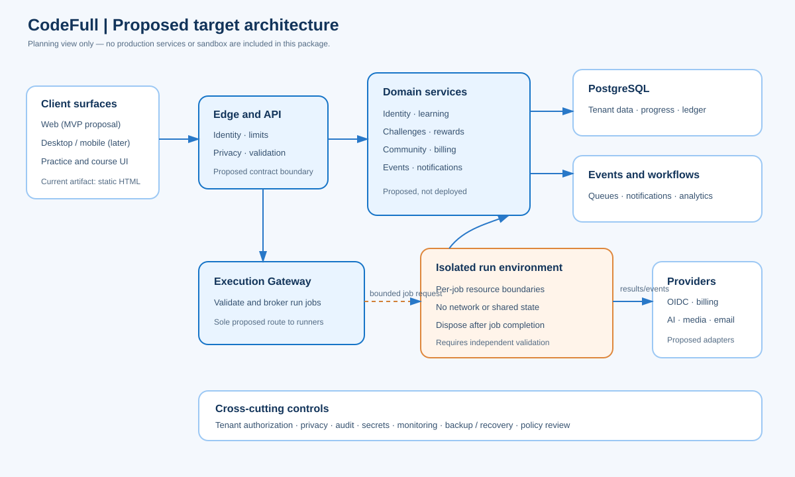
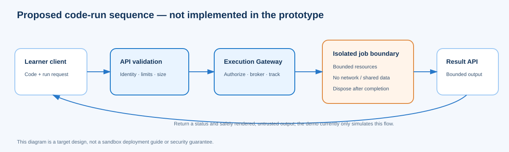

# Architecture

**Status:** proposed target design summarized from the supplied Backend Plan and Architecture draft. The system described here has not been built or deployed.

## Design goals

- Support learning and coding practice through one consistent web/API contract.
- Keep tenant, profile-privacy, and anonymous-entry rules enforced on the server.
- Make scoring and rewards replay-safe and auditable.
- Treat user code as untrusted input and keep execution behind a dedicated, independently reviewed boundary.
- Use asynchronous events for non-interactive work such as progression, notifications, and analytics.
- Begin with the smallest architecture that passes measured feasibility and security gates; do not assume the draft service count is the MVP implementation.

## Proposed system view

| Component | Proposed responsibility |
|---|---|
| Web client | Learning, account, challenge, playground, and progress experiences; prototype is currently one static HTML file |
| Edge/API gateway | Proposed authentication validation, request limits, routing, and trusted identity context |
| Domain APIs | Identity/privacy, courses/progress, challenge/submission, rewards, community, and billing rules |
| Data access boundary | Proposed single database access layer that applies tenant/user context and database policies |
| PostgreSQL | Proposed system of record for users, lessons, progress, submissions, and immutable reward entries |
| Event/workflow services | Proposed durable processing for judging results, progression awards, notifications, and later prize settlement |
| Execution gateway | Proposed sole broker for bounded code-run jobs; no ordinary application service directly starts user code |
| Run isolation tier | Proposed isolated runtime environments with per-job limits, no network access, and disposable job state |
| External services | Identity, payment, AI, content/media delivery, email, and push providers; none are configured by this package |

## Request and trust flow

For an authenticated request, a future gateway would verify the client identity and establish a trusted user/workspace context. The domain service would authorize the requested action, validate its input, then use an approved data-access path. Tenant policies and application authorization should independently restrict access. Cross-tenant or public reads need narrow, audited projections that honor privacy settings.

For a code run, the client submits a bounded request to an API endpoint. The service validates language, size, account allowance, and job status; the execution gateway brokers a job to an isolated runtime; a result is returned as untrusted output and safely displayed. The demo playground currently simulates this flow. It does not execute programs in a sandbox.

## Untrusted-code boundary

The backend plan proposes defense in depth: a dedicated gateway, separate runtime pools, enforced CPU/memory/process/time/output budgets, restricted filesystem, no network path, separation from service credentials, disposal after each run, and independent escape testing. A later hardened tier is proposed for competition runs.

These are architectural requirements to validate, not a checklist that makes a system secure by declaration. A safe production runner needs a concrete threat model, supported runtime/image lifecycle, restrictive infrastructure policy, abuse/cost controls, monitoring, incident response, and external review. Do not copy executable sandbox configurations from planning examples into production without specialist review. The [lessons learned](lessons-learned.md) describe this boundary and remaining readiness gaps at a high level.

## Rewards and data flow

The rewards plan proposes an append-only, double-entry points ledger. Verified domain events—not client-supplied balances—would drive postings through one idempotent transaction. Competition Score, XP, spendable points, and community reputation must remain distinct values. Reward and settlement decisions require auditability and reconciliation.

## Release assumptions to validate

The source plan proposes PostgreSQL, Redis, NATS, Temporal, and separate Python/Go services. It also names capacity, latency, and availability targets. These are unvalidated architectural proposals. Before committing to the full design:

1. Decide and document the MVP service boundaries and deployment model.
2. Measure execution isolation throughput, operating cost, and operational complexity in a controlled PoC.
3. Measure realtime and ledger behavior under representative, authorized test loads.
4. Prove tenant/privacy policies using automated negative tests.
5. Establish owners, key management, backup/restore, on-call, and incident readiness.

See the original architecture, test, and security drafts under `src/backend plan/source-materials/`.
