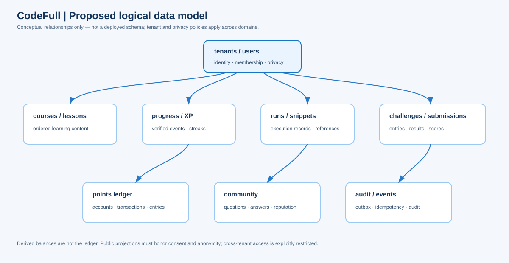

# Data model

**Status:** logical overview based on the supplied Data Model Specification. It is a draft target schema, not a database migration or deployed data store.

## Modeling principles

- Use UUID identifiers and UTC timestamps, as proposed by the source specification.
- Scope tenant-owned rows explicitly and enforce access through both application checks and database row-level policies.
- Keep privacy preferences and consent records separate from public-facing profile projections.
- Represent earned/spent points with immutable, balanced ledger postings; derive cached balances from the ledger.
- Keep code, lesson assets, and large submissions in access-controlled object storage where retention permits.
- Apply explicit retention, deletion, and de-identification rules to personal data and retained accounting records.

## Main entity groups

| Area | Representative entities | Important relationship |
|---|---|---|
| Identity | `tenants`, `users`, `memberships`, `user_profiles`, `privacy_settings`, `consent_records` | Users join workspaces through memberships; public views honor current consent/settings |
| Learning | `courses`, `modules`, `lessons`, `lesson_formats`, `enrollments`, `lesson_progress`, `xp_events`, `streaks` | Courses contain ordered modules/lessons; progress events are verified and idempotent |
| Execution | `runs`, `snippets`, `usage_counters` | A run belongs to a user and has a bounded lifecycle and output-retention policy |
| Challenges | `challenges`, `challenge_tests`, `entries`, `submissions`, `scores` | Hidden tests are restricted to judging; submissions reference entries and challenge versions |
| Rewards | `ledger_accounts`, `ledger_transactions`, `ledger_entries`, `catalog_items`, `user_unlocks` | A posting transaction balances; spendable buckets and competition score are distinct |
| Community | `questions`, `answers`, `votes`, `discreet_assignments`, `reputation_events` | Discreet content is visible only to authorized participants and moderators |
| Platform | `outbox_events`, `processed_events`, `idempotency_keys`, `audit_log` | State changes and outbox records commit atomically; consumers deduplicate events |

## Key invariants

### Learning and progression

XP records are derived from eligible learning events, with a unique source reference to prevent duplicate awards. Per-tier XP drives advancement; the points economy document distinguishes XP, spendable points, Competition Score, and reputation. Cached totals must be reconciled with their source events.

### Submissions

Store submission status and the resulting verdict separately from hidden challenge test material. Keep an auditable link between request, judging job, challenge version, and result. The learner-facing result should not expose hidden tests or other participants’ private information.

### Rewards ledger

For each ledger transaction, total debits equal total credits and all writes are atomic and idempotent. Runtime roles should not update or delete ledger history. A projection may accelerate balance reads, but the ledger remains authoritative and must be reconciled.

### Privacy and tenancy

Tenant context is derived from trusted membership. Row-level policies should deny access when context is absent. Public portfolio, leaderboard, and search projections must reveal only explicitly public fields; private challenge entries and discreet questions are excluded from shared feeds and indexes.

## Data lifecycle

The source specification proposes retention periods for submissions, AI messages, logs, and audit history. These values require legal and product approval. Account deletion should remove or de-identify personal data consistently across primary stores, search, caches, exports, and analytics while preserving only records whose retention is justified. Never treat “soft delete” by itself as a complete privacy workflow.

## Proposed ERD

The diagram is intentionally logical and omits the full schema. Refer to the source DM-001 draft for candidate columns, access roles, policies, and migration conventions. Production schema design must be verified by migration tests, tenant-isolation tests, and restore exercises.
