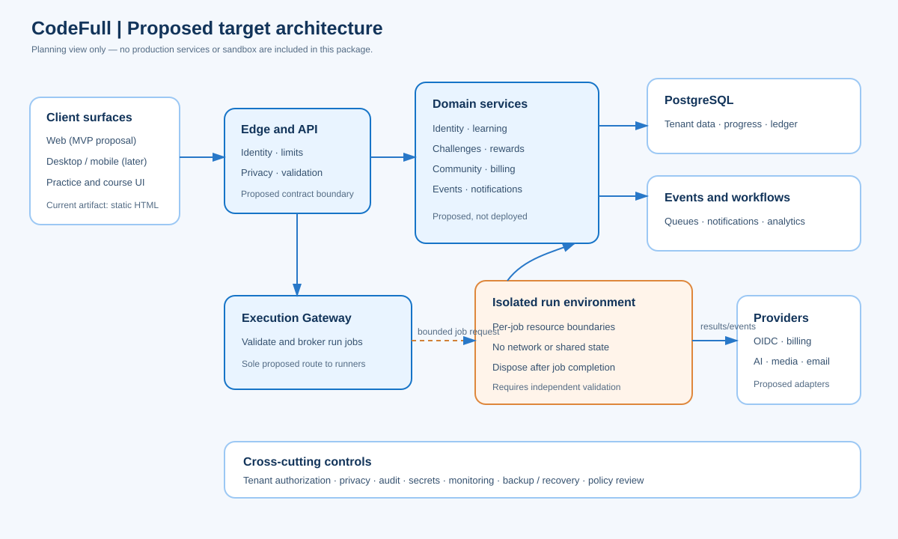

# CodeFull

CodeFull is a **proposed learning and practice platform for programming**. Its product idea connects structured learning, a coding playground, solo challenges, community support, and a portfolio that learners control.

> **Current state:** the supplied interactive HTML is a static design prototype. It contains hard-coded/sample data and simulated actions. This package does not include a production backend, live judge, authentication service, or sandbox.

## Product vision

Help learners build programming skills through a steady loop:

**Learn → practice → get feedback → demonstrate progress → choose what to share.**

Competition, community support, and rewards are intended to motivate practice, while privacy settings let learners decide whether a result or profile is public. The [product spec](product-spec.md) summarizes the proposed users, journeys, release boundaries, and success measures.

## Proposed first release

The source PRD proposes a responsive web MVP with one substantial learning track, beginner-to-intermediate progression, Python and JavaScript practice, solo challenges, a basic AI tutor, and a small in-app rewards catalog. Cash or gift-card redemption is explicitly out of the MVP proposal and remains gated behind legal and policy review.

## Architecture and data

The planning set describes a contract-first service architecture with identity, learning, challenges, rewards, and execution domains. Its proposed execution path has a dedicated gateway and strongly isolated, resource-limited job environments. These controls are design intentions, not implemented protections or a claim that arbitrary user code is safe to run.

Explore the [architecture](architecture.md), [API outline](api-design.md), [data model](data-model.md), and [prototype lessons](lessons-learned.md).

## UX artifacts

The learning-flow map, content-organization map, and early wireframe are included in the repository’s `prototype/` directory. They are concept artifacts, not approved requirements or evidence of a deployed workflow.

Screenshots in the project README are captured from the supplied HTML. Numeric activity and reward claims shown there are placeholders and must not be used as evidence of real usage.

## Decisions and readiness

The original documents mark key plans as draft or for review. In particular, legal/compliance policies, content authorship and licensing, cloud/region, operating capacity, sandbox feasibility, and service costs still require owners and validation. The [lessons learned](lessons-learned.md) page calls out these gaps without implying a production incident or completed security review.
